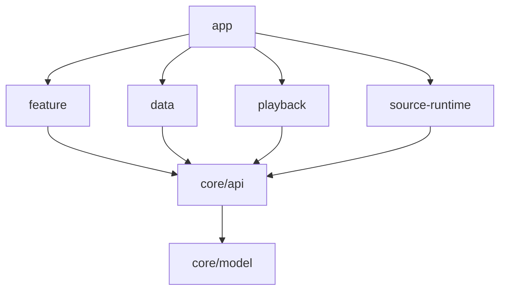

# 原生安卓架构提案（核心评审文档）

状态：待 June 批准。2026-11-13。本文定义干净起步的结构；本 PR 不创建应用、构建脚本或 CI。先批准架构与第 0 阶段，再写骨架和功能。mobile 只用于确认用户能力与协议，证据范围见 [LEGACY-AUDIT](LEGACY-AUDIT.md)。server 原样复用，原生 App 是另一个客户端。

## 平台与技术选择

| 决策 | 建议与取舍 |
| --- | --- |
| 语言/UI | Kotlin、Jetpack Compose；协程、Flow/StateFlow；不引入 RN、JS UI 或跨平台桥接 |
| 播放 | Media3 的 ExoPlayer、MediaSessionService、MediaController；一个服务拥有播放器、队列和音频焦点；不再包装成另一套播放器框架 |
| 持久化 | Room 管理歌单、歌曲、同步记录、设置与恢复快照；数据层直接使用 DAO，不再创建通用 storage/repository 包装层 |
| 网络 | OkHttp HTTP/WebSocket，kotlinx.serialization 显式 DTO；只在边界解析 JSON；协议 codec 不暴露给 UI |
| 自定义音源 | QuickJS；mobile 的 `android/app/src/main/java/cn/lux/music/mobile/userApi/QuickJS.java` 确有 JS 环境、原生调用、编码/摘要桥接，`src/core/init/userApi/index.ts` 实际处理 musicUrl/lyric/pic、HTTP 与取消。因此保留脚本能力有依据，但不复制 RN bridge。WebView 会扩大 DOM/页面生命周期面，纯 Kotlin 无法执行既有 JS 脚本。具体 QuickJS 绑定、版本、许可证、ABI 与中断支持在第 0 阶段专项验证，尚未选定依赖坐标 |
| 应用标识 | 建议 `cn.lux.music.android`，namespace 同名。mobile 的 `android/app/build.gradle:109–154` 定义标准版 `cn.lux.music.mobile`、vivo 版 `com.luna.music`，namespace 为前者。新标识与两者均不同；provider authority 从新 applicationId 派生，不复用 RN 的文件目录或组件名。第 0 阶段验收三者同时安装 |
| 最低系统 | **建议 minSdk = 33（Android 13）**，待 June 决定。mobile 的 `android/build.gradle:8` 是 21；[审计 A1–A5](LEGACY-AUDIT.md) 可见 API 23/26/29/33 的分支。33 可以直接淘汰这些旧分支，并统一通知权限基线，代价是放弃 Android 12 及以下设备。没有用户设备占比证据，不声称覆盖率；若要降低门槛，必须另写 ADR 量化新增复杂度，不默认补 shim。compile/target SDK 及依赖版本在批准后的骨架 PR 核对当时官方要求后锁定，不能把 minSdk 当成 targetSdk |

QuickJS 在独立受限运行环境执行：优先独立进程，单线程上下文、内存/栈/执行期限上限，超时可中断或终止工作进程；HTTP 由宿主执行，限定请求数、响应大小、超时及允许的 URL scheme。不开放反射、任意文件、账号凭据、数据库和播放器对象。脚本更新必须显式确认；脚本只返回强类型结果。若选定绑定无法可靠终止死循环，第 0 阶段不通过。脚本 ABI 仅保留经样例证明需要的事件/工具集，不承诺完整复刻旧 preload。

## 模块布局与编译依赖

以下是待实施目录，当前不创建。按边界拆分，不按每个页面创建 Gradle 模块。

```text
app/                 应用入口、导航、依赖组装、服务注册
core/model/          不可变领域值、ID、命令与错误（纯 Kotlin）
core/api/            UI/服务使用的业务端口（纯 Kotlin，依赖 model）
data/                唯一数据层：端口实现、Room、HTTP/WS、同步协调
  local/             DAO/entity、事务、schema
  remote/            HTTP DTO、WS/RPC codec、wire 映射
  sync/              会话代际、同步状态机、待发送记录
playback/            Media3 服务与 PlaybackControl 端口实现
source-runtime/      QuickJS 与 SourceResolver 端口实现
feature/             Compose 页面、ViewModel、UiState
```

编译依赖（箭头表示“允许依赖”）：



`app` 是唯一组装点。`feature` 内可按 player/search/library/account/lyrics 分包，禁止相互访问 ViewModel；共同数据走端口。`data`、`playback`、`source-runtime` 不互相编译依赖，只接受 `core/api` 端口注入；禁止任何 core 引用 Android、Room、Compose、网络或业务实现，禁止 data 引用 UI，禁止实现模块引用 app。DAO、Entity、DTO、codec、QuickJS context 均为实现内部可见，禁止通过 `api` 配置传递导出。暂不建立独立 domain/usecase/repository 链；业务规则放值对象或唯一数据层命令处理，只有实际出现独立复杂规则时才另行评审拆分。

## 接口与执行路径

接口名称是设计，不是现有服务端方法：

| 端口（core/api） | 输入/输出 | 唯一实现/职责 |
| --- | --- | --- |
| Library | observePlaylists/observeSongs 返回 Flow；execute 接收 PlaylistCommand，返回显式成功/失败 | data；本地事务与同步变更记录一起提交 |
| Catalog | search(SearchQuery) 返回有界分页 Song；resolveLyric(SongId) | data；平台适配/DTO 映射；需要脚本时使用 SourceResolver |
| SourceResolver | resolve(SourceRequest) 返回 ResolvedAudio/Lyric/Artwork 或 SourceFailure | source-runtime；能力协商、隔离与取消；宿主 HTTP 使用注入的 ScriptHttp 端口 |
| PlaybackControl | dispatch(PlaybackCommand)，observe 返回 StateFlow<PlaybackState> | playback；服务串行处理命令，UI 通过控制器观察 |
| Session | observe 返回登录状态；login/logout，返回类型化错误 | data；唯一会话状态机、凭据生命周期 |
| SyncControl | observe 返回 SyncState；connect/retry/resolveConflict | data；通过同一个 DAO/事务路径应用远端变更，不再包 Library 实现 |

用户操作 → ViewModel 意图 → 业务端口 → 唯一实现 → 状态流 → UiState → Compose。UI 不持久化歌单，不直连 WS，不对 DTO 做业务判断。短暂的输入框、滚动位置、弹窗保留在 UI；成功修改后以 Room 发射为准，不再同步修改第二份列表。

## 强类型领域与 wire 的隔离

- SongId、PlaylistId、SourceId、DeviceId、AccountSpaceId、SyncRecordId 使用不同值类型，禁止混用裸字符串。账号空间由“规范化服务器身份 + 服务端用户身份”确定，本地空间另作明确变体。
- Song 为不可变值：id、title、artistText、album、可空 Duration、来源判别联合。OnlineSong 的 ProviderIdentity 按来源细分；LocalSong 只持有受许可的 content URI。wire 的 `interval` 字符串、`songId: string | number`、平台专有 meta 只在 DTO 映射中处理。不能根据标题重新生成同步 id，也不能在领域层丢弃平台解析 URL 所需的身份字段。
- Playlist 是元信息与有序 PlaylistEntry 的不可变投影，歌曲顺序由 entry position 表达；不存在页面私有的可变歌单副本。wire `default`/`love` 是保留 ID，`tempList` 与可同步歌单分开。
- QueueEntryId 与 SongId 分离，队列允许同歌多次出现；PlaybackState 含 queue、currentEntry、position、duration、状态与错误。服务为唯一拥有者。
- SourceSpec 含 ScriptId、版本、明确 Capability 集与启用状态；请求/返回使用 sealed 类型，禁止 `Map<String, Any>` 承载音源能力。
- SyncRecord 为强类型变更、所属账号空间、连接代际、状态（Pending/InFlight/Acknowledged/NeedsReconcile/Failed）；本地记录 ID 不伪装成服务端幂等键。SyncState 为断开、连接、协商、同步、冲突、就绪、失败的 sealed 状态。
- PlayRecord 按 server wire 映射为不可变值，时间使用明确毫秒/Instant，completed/skipped 互斥；不能把播放队列误作统计来源。

所有 public 业务 API 禁用 `Any`、可变集合、原始 JsonElement/JSONObject 与泛型键值袋；合法的强类型映射可以存在。未知 wire 字段仅留在 remote 内部受限扩展容器，不流向领域。无法无损往返的歌曲先报告不可写状态，不静默覆盖服务器。强类型不等于随意缩减协议字段，详见 [SYNC-CONTRACT](SYNC-CONTRACT.md)。

## 单一事实源与一层数据层

| 数据 | 权威来源 | 边界 |
| --- | --- | --- |
| 歌单、收藏、歌曲、同步待办、历史、设置 | 当前账号空间的 Room | 唯一数据层暴露 Flow；网络结果先验证并在事务内写 Room，页面只读投影 |
| 正在运行的播放状态、活动队列 | Media3 服务 | Room 只存重启恢复快照，不能作为第二个实时队列；恢复须由服务接管后发布 |
| 会话 | data 的 Session 状态机 | token/key 存 Android Keystore 保护的私有存储，Room 只记非敏感引用；不另建可独立登录的设置状态 |
| 搜索结果、请求进度 | 单次请求/所属 ViewModel | 搜索不是持久库的第二份镜像；取消后不更新过期页面 |
| 音频字节 | Media3 单一缓存管理器 | Room 只记必要索引，不再建第二个字节缓存；图片库磁盘缓存只存图片，不成为歌曲元信息来源 |

本地编辑在同一 Room 事务写业务表和待发送记录；远端编辑也通过 data 内部同一事务入口，但标记 Remote 不再生成回传事件。没有 repository 调用另一个 repository，没有 UI/内存 Map 与磁盘双写，没有独立 SyncRepository 复制歌单。离线可编辑，联网后先协商/协调再发送；协议缺少幂等操作 ID，超时后不盲目重放，转 NeedsReconcile 并用服务端快照对齐，必要时再次询问冲突策略。

切换账号先取消连接/请求、递增代际，再事务切换空间并发布状态；旧代际返回值不得提交。退出清理内存会话与服务控制连接，保留/清除本地副本须显式选择，不能把一个账号待办投到另一个账号。服务端数据的跨设备事实由 server 负责，本地 Room 是该客户端可观察的持久化事实源，两者由同步状态明确衔接。

v1 **默认不导入 RN 本地遗留数据**。不读它的 AsyncStorage、缓存、旧设置或私有路径；账号歌单以 server 同步为准。独立包名也不应绕过沙箱读取旧应用。用户需先在 mobile 完成同步；仅本地的临时队列、设置或未上传数据不会自动出现，需在引导中说明。若 June 要求离线文件导入，另开有用户选文件、格式校验、预览、撤销和失败隔离的 ADR/PR；当前没有批准的例外。

## 门禁：让容易走的路就是正确的路

按 June 的 poteto 优先级实施，以下全部是后续方案，本 PR 不添加 workflow。

1. **结构优先**：core 纯 Kotlin；实现类 internal；app 组装；feature 仅可引用 core/api；DAO 不对外；数据库唯一写入入口统一处理空间/代际/Remote 来源。通过依赖声明直接阻止 UI 调用数据库和循环引用，优于靠审查记忆。
2. **静态检查**：Kotlin 显式 API 模式与编译警告治理；Android Lint（NewApi、ObsoleteSdkInt、Deprecated API 对新增代码失败）；ktlint；Detekt 自定义规则禁止业务 API 中 Any/裸 JSON/可变暴露，禁止 `@SuppressLint`/反射规避平台基线，扫描 SDK_INT 低于 minSdk 的死分支。新增高版本必要判断只限 Android 边界，须有真实设备行为理由。Gradle 依赖图白名单与环检测，对新增模块默认拒绝未列边；检查 feature 不引用实现包。具体工具版本及规则兼容性在骨架 PR 验证，不声称工具已经能自动证明无双写。
3. **测试**：领域不变式（同歌多队列项、保留 ID）、Room 事务回滚与账号隔离、远端操作不回传、进程死亡恢复；fake server 契约样例覆盖 codec 顺序、冲突取消、半途断线与未知字段；QuickJS 死循环/资源耗尽/取消；Media3 后台与音频焦点真机测试。以可观察行为为断言，不复制实现。
4. **文档**：ADR 记录例外、契约 fixture 来源提交、状态所有权表；结构/协议变化同步更新本文。禁止泛化 Compat/Legacy/Bridge 模块作为默认逃生门。
5. **人工审查最后兜底**：小 PR 展示依赖变化、单一写入路径、账号切换及失败恢复证据。任何有意降低 minSdk、引入第二事实源或改 server 契约的变更必须先获 June 架构批准。

后续 PR CI 建议：文档链接检查 → 编译/依赖图/静态检查 → JVM/Room 契约测试 → minSdk 与选定最新系统的 instrumentation；每项失败阻止合入的规则需 June 以后批准配置。本仓库规则先以 [AGENTS.md](../AGENTS.md) 生效；没有设置分支保护或声称 CI 已落地。正式进入功能开发前，第 0 阶段要演示至少四个反例被门禁拒绝：feature 依赖 data、core 引用 Android、公开 Any DTO、低于 33 的兼容分支，并证明事务失败不会留下孤立待办。
