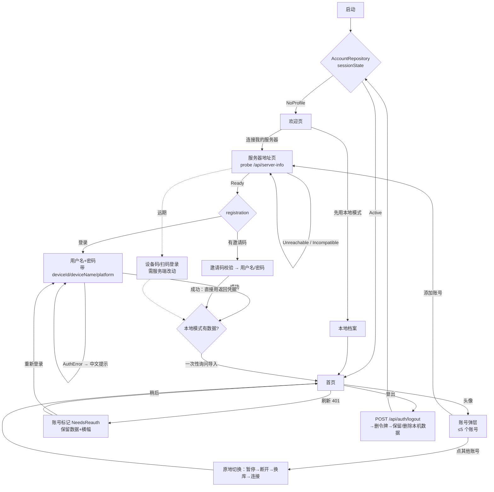

# lux-music-android 登录 / 注册 / 账号切换：参考调研

> 调研时间：2026-11-13（太平洋时间）。本文只出方案，不改任何代码。
> 依据：
> - **lux-music-mobile**：只读工作树 `/workspace/codex-dev/playdetail-fixed-lyric-height`，HEAD `3ab131e1`（2026-11-12 07:42 PT）。
> - **lux-music-server**：只读工作树 `/workspace/codex-dev/_base-server`，HEAD `794fcc4c`。它和 GitHub 上 `origin/dev` 当前的 head 一致（2026-10-17 16:10 PT，已用 GitHub API 核对）。
> - **开源项目**：源码用 GitHub API 和 raw 文件读取，没有 clone。stars 和最近 push 时间是 2026-11-13 凌晨（PT）从 GitHub API 取的。
> - **商业 App**：只引用官方帮助页、官方隐私政策和可以公开访问的页面。核实不了的标为 **待确认**。
>
> 标记说明：**【需服务端改动】** 指现在的 server 没有这个能力，要改 lux-music-server。

---

## 1. 现状诊断

### 1.1 服务端实际支持什么（以代码为准）

| 能力 | 现状 | 代码位置 |
| --- | --- | --- |
| 注册 | **只能凭邀请码注册**。先调 `POST/GET /api/auth/invite/check` 校验邀请码（返回邀请人名称、角色、过期时间），再调 `POST /api/auth/register`，字段是 inviteCode、username、password，displayName 可选。注册成功会直接返回整套登录凭据。 | `src/server/api/auth.ts:55-102` |
| 注册开关 | `/api/server-info` 里写死了 `registration: { inviteOnly: true, enabled: true }`，不能配置。 | `src/server/app.ts:139` |
| 密码登录 | `POST /api/auth/login`，用 username 和 password。可以额外带 `deviceId`、`deviceName`、`platform`。 | `src/server/api/auth.ts:104-124`、`:38-52` |
| 令牌 | 同时发三种：① 旧版 `token`：14 天，不带 sid；② `accessToken`：默认 1 小时，带 sid，可用 `LUX_ACCESS_TOKEN_TTL_SECONDS` 调；③ `refreshToken`：不透明随机串，默认 90 天，每次刷新滑动续期，可用 `LUX_REFRESH_TOKEN_TTL_DAYS` 调。刷新时会轮换新 refreshToken，重放旧的会撤销整个会话。 | `src/account/token.ts:28`、`src/server/api/auth.ts:27-36,126-140`、`src/account/sessions.ts:50-97` |
| 同一设备重复登录 | 如果带了非空的 `deviceId`，同一账号用同一 deviceId 再登录，会撤销旧会话。不带 deviceId 的话，每登录一次就多一个会话。 | `src/account/sessions.ts:56-58` |
| 多用户 | 支持。一个服务器可以有多个托管账号，角色是 admin 或 user。管理员可以建用户、发邀请码、重置密码、禁用或删除用户。 | `src/server/api/admin.ts`、`docs/user-models.md` |
| 会话管理 | `GET /api/me/sessions` 列出会话；`DELETE /api/me/sessions/:id` 撤销一个；`POST /api/me/sessions/revoke-others` 撤销其他所有会话。 | `src/server/api/me.ts:93-119` |
| 同步设备 | `GET/DELETE /api/me/devices` 管理的是同步密钥（clientId），**和会话是两套列表**。`POST /api/sync/key` 用 Bearer token 换同步密钥，密钥绑定当前 sid。 | `src/server/api/me.ts:121-132`、`src/server/api/sync.ts:8-43` |
| 设备数量上限 | **没有**。在 src 里搜不到 maxDevice、deviceLimit 这类代码。 | — |
| 改密码 | `POST /api/me/password`。`revokeOtherDevices` 默认为 true，会踢掉其他设备。 | `src/server/api/me.ts:139-171` |
| 登出 | `POST /api/auth/logout`。带 sid 的令牌只撤销当前会话，同时删除绑定的同步密钥并断开连接。 | `src/server/api/auth.ts:146-152`、`docs/user-models.md` §4 |
| 忘记密码 | **没有自助找回**：账号没有邮箱字段，也没有找回接口。只能由管理员重置（`/api/admin/users/:id/password/reset`）。 | `src/server/api/admin.ts:111` |
| 第三方登录、扫码登录、设备码登录、Passkey、两步验证 | **都没有**。 | — |
| 自助注销账号 | **没有**，只有管理员能删除用户。 | `src/server/api/me.ts` 里没有这个接口 |
| 服务器信息 | `GET /api/server-info` 返回 name、version、minClientVersion、publicUrl、adminContact、registration、features。**不带 serverId**。serverId 只能从旧协议的 `GET /id` 拿。 | `src/server/app.ts:119-141` |
| 错误码 | `/api/*` 统一返回 `{ message, code }`，有一份文档化的错误码表。但注册时"用户名已存在"返回的是笼统的 `INVALID_REQUEST`，message 是英文的 `User name already exists`。 | `docs/api-errors.md`、`src/server/api/auth.ts:98-101`、`src/account/store.ts:268` |
| 密码策略 | **服务端不校验**用户名格式和密码长度（`createUser` 里没有相关检查）。"至少 8 位"只在客户端判断。 | `src/account/store.ts:256-270`；客户端 `src/utils/luxAuthApi.ts:31` |
| 失败限流 | 同一 IP 或同一用户名失败 10 次后返回 429。计数存在进程内的 LRU 里，TTL 2 天，每次写入都会刷新 TTL，所以触发后最长要等约 2 天才解封。响应里不带 Retry-After。旧协议 `/ah` 也是同一 IP 失败 10 次就封。 | `src/server/api/rateLimit.ts:5-33`、`src/utils/cache.ts:6`、`src/server/auth.ts:33` |
| PAT | 个人访问令牌，供 MCP 和 `/api/v1/*` 使用，不属于登录流程。 | `src/server/api/pats.ts` |

### 1.2 lux-music-mobile 的具体问题

先看历史：登录和账号相关的提交非常多，最近一轮是"登录收敛 PR1–PR3"（#157、#160、#161）。后面又有账号页的 #175、#178。光是 `src/screens/SyncLogin`、`src/screens/Login`、`src/core/appSession`、`auth.ts`、`data.ts`、`loginGate.ts`、`src/screens/Account` 这几处，2026-06 以来就有 38 个提交（`git log --since=2026-06-01 -- <这些路径>`）。问题主要出在结构上，不是缺功能。

**A. 流程和页面：入口多，同一件事有好几套实现**

1. **三种"身份"叠在一起**。`LoginProvider = 'local' | 'lx' | 'lux'`（`src/utils/loginSession.ts:6`）。`ActiveSession` 是三选一的联合类型（`:11-14`），`LoginIntent.reason` 有 7 种取值（`:17`）。用户要理解本地、LX 连接码、Lux 账号三套概念。
2. **两套登录 UI 同时存在**：
   - 旧的 `LegacySyncLogin`（`src/screens/SyncLogin/index.tsx:49`，共 444 行）
   - 新的 `LoginGate`（`src/screens/SyncLogin/LoginGate.tsx`，305 行）
   - 另外还有 `screens/Login/{index,AuthFlow,ServerStep,ChangePassword}.tsx`
   - `AuthFlow` 同时被新旧两条路径复用（`LoginGate.tsx:101`）
3. **新旧两套会话实现靠运行时开关切换**。`isSessionCoordinatorEnabled()` 在 10 个文件里出现了 19 次。例如：
   - `src/core/appSession/index.ts:279` 会退回 `legacyConnectLuxServer`
   - `src/utils/syncLogout.ts:11` 的登出也分两个分支
   - `src/screens/Login/AuthFlow.tsx:119` 也分两个分支
   每改一处都要两条路径各测一遍。
4. **切换账号要整屏跳转**。切换账号时调 `requestLogin`，它会先暂停播放、停掉下载、写日志、断开同步，再 `replaceWithLoginGate` 替换到登录页，并弹一条"已暂停"的 toast（`src/core/appSession/index.ts:89-99`）。账号空间页的"切换"按钮也走这条路（`src/utils/accountSpaceSwitch.ts:22`）。所以每次切换都等于"退出再登录"，和 Spotify、Bitwarden 那种点头像就切换的体验差得很远。
5. **切换事务很重**。`AppSessionCoordinator` 有 4 个阶段（gatePending、authenticating、preparing、committing），日志要持久化到 AsyncStorage，崩溃恢复时还要重新认证（`src/core/appSession/coordinator.ts:9,53-68`）。这是在给"同时只能有一个活动数据空间"的架构打补丁，复杂度来自于数据没有按账号隔离。
6. **Lux 账号登录还要先走旧协议**。登录前要先请求 `/hello` 和 `/id`，然后才请求 `/api/server-info`（`src/plugins/sync/client/auth.ts:165-177`）。原因是 server-info 不带 serverId（见 1.1）。

**B. 状态：数据源分散，同一份数据有多份副本**

7. 当前账号的信息同时存在好几处：
   - AsyncStorage：`appSessionActive:v1`、`appSessionOffline:v1`、`appSessionJournal:v1`（`src/core/appSession/index.ts:14-16`）
   - `@lux_auth` 和 `@lux_auth_servers`（`src/config/constant.ts:67-68`）
   - `@sync_auth_key`（`:63`）
   - 登录草稿 `@sync_login_draft`（`:70`）
   - 最近登录列表 `loginRecents`
   - 服务器地址历史
   - 模块级变量 `active`、`intent`、`offline`（`src/core/appSession/index.ts:17-20`）

   还要额外加串行写锁（`withLuxAuthWrite`，`src/utils/data.ts:557-561`），防止 active 和 sessions 写乱。
8. 冷启动时，还要从旧字段 `getSyncLoginCompleted`、`getSyncMode`、`getLuxAuth`、`getSyncHost` 反推当前身份（`src/core/appSession/index.ts:125-147`）。

**C. 错误处理：直接把原始英文报错给用户看**

9. 登录页把 `error.message` 原样显示出来（`LoginGate.tsx:49`），`requestLogin` 失败时也直接 toast `error.message`（`src/core/appSession/index.ts:119-122`）。这些 message 包括代码里写死的英文：`'Login identity mismatch'`（`auth.ts:169,189,216`）、`'Session changed'`、`'Data space is not ready'`，也包括服务端返回的英文 message。
10. 没有按 `code` 分出错误类型。服务端已经提供了 `code`（`docs/api-errors.md`），客户端只区分了少数几种 HTTP 状态（例如 `auth.ts:191-194`）。

**D. 多账号和登录会话**

11. **登录和注册都没带设备信息**。`/api/auth/login` 的请求体只有 `{ username, password }`（`auth.ts:182`），注册也一样（`src/utils/luxAuthApi.ts:123-125`）。后果：
    - 服务端会话没有 deviceId，每次登录都会新增一个会话，旧会话撤销不掉（server `sessions.ts:56`）。
    - "我的设备"页的设备名拿 `deviceName || deviceId` 兜底（`src/utils/accountPage.ts:14`），两个都是空，所以名字显示不出来。
12. **注册时多出一个白白存在的会话**。`AuthFlow` 注册成功后把返回的凭据丢掉了，又用同一套账号密码再登录一次（`src/screens/Login/AuthFlow.tsx:118,130`）。注册时建的那个会话和它的 refreshToken 会在服务端留 90 天。
13. **登出不通知服务端**。mobile 全仓都没有调用 `/api/auth/logout`，`rg "auth/logout"` 搜不到。`applySyncAccountLogout` 只清本地凭据（`src/utils/syncLogout.ts:8-21`）。所以服务端的会话、refreshToken 和绑定的同步密钥都还有效，最长 90 天。
14. **会话过期会先删凭据**。处理过期时先 `clearLuxAuthForServer` 删掉本地凭据（`src/plugins/sync/client/sessionExpired.ts:60`），再用 `returnPolicy: 'none'` 强制跳回登录页（`:23`）。用户回不到之前的账号，也没有"稍后再说、先离线听歌"的选项（新路径直接 `later()`，`:33`）。

**E. 令牌和密钥的存储**

15. **只有 refreshToken 放进了 Keystore**（react-native-keychain）。配置是 `SECURE_SOFTWARE` 加 `AES_GCM_NO_AUTH`（`src/utils/secureCredentials.ts:23-29`），没有要求硬件级保护。迁移逻辑 `withoutLuxSecrets` 只去掉了 refreshToken 和 password（`src/utils/secureCredentialMigration.ts:7-10`），所以 accessToken（`token` 字段）和用户信息还是明文写在 AsyncStorage 的 `@lux_auth` 和 `@lux_auth_servers` 里（`src/utils/data.ts:584`）。
16. **LX 连接码明文存在登录草稿里**（`src/utils/syncLoginPrefill.ts:83-87`，`@sync_login_draft`）。旧版草稿类型里还有 `luxPassword` 字段（`src/types/sync.d.ts:22-29`），说明以前明文存过密码，后来才补了迁移清理（`scrubPasswords`）。

**F. 服务器地址输入**

17. 新版 `ServerStep` 的服务器检测做得不错，会显示是否可达、延迟、是否兼容、是否 https、能否注册（`src/screens/Login/ServerStep.tsx:84-92`），**值得保留**。问题有两个：
    - 旧版 `LegacySyncLogin` 里还保留着另一套地址输入和校验正则（`src/screens/SyncLogin/index.tsx:47`）。
    - 地址历史、草稿、最近登录是三份不同的数据。

**G. 设备注册**

18. 设备 ID 有两套概念：
    - 同步设备：`getSyncDeviceId`，用于 `/api/sync/key` 和 LX 第 5 行。
    - 服务端会话：没有 deviceId，见第 11 条。
    服务端"会话"和"同步设备"本来就是两张表（1.1），客户端没把它们关联起来展示，用户分不清"设备"到底指什么。

---

## 2. 开源参考（已逐个核对仓库存在、stars、最近 push 和许可证，并读了源码）

> 许可证提醒：下面多数项目是 GPL 或 AGPL，**只借鉴设计，不能复制代码**。Thunderbird 和 Now in Android 是 Apache-2.0。

| # | 仓库 | stars | 最近 push（PT） | 许可证 | 为什么选它 |
| --- | --- | --- | --- | --- | --- |
| 1 | [element-hq/element-x-android](https://github.com/element-hq/element-x-android) | 2504 | 2026-11-13 | AGPL-3.0 | 选择自建服务器、登录、多会话存储，Compose 写法 |
| 2 | [bitwarden/android](https://github.com/bitwarden/android) | 9625 | 2026-11-13 | GPL-3.0 | 自托管地址、账号切换器（上限 5 个）、登出原因的类型建模、Keystore 加密存储 |
| 3 | [nextcloud/android](https://github.com/nextcloud/android) | 5701 | 2026-11-13 | GPL-2.0（部分文件头写的是 AGPL-3.0-or-later） | 多账号、服务器 URL、浏览器登录流 v2、扫码 |
| 4 | [Automattic/pocket-casts-android](https://github.com/Automattic/pocket-casts-android) | 2855 | 2026-11-13 | MPL-2.0 | 音频类 App 的登录、AccountManager、Credential Manager 接 Google 登录、TV 扫码登录 |
| 5 | [jellyfin/jellyfin-androidtv](https://github.com/jellyfin/jellyfin-androidtv) | 4735 | 2026-11-12 | GPL-2.0 | 自建媒体服务器：局域网发现、多服务器多用户、Quick Connect 设备码登录 |
| 6 | [jarnedemeulemeester/findroid](https://github.com/jarnedemeulemeester/findroid) | 4311 | 2026-11-11 | GPL-3.0 | Jellyfin 客户端，Compose 版的"添加服务器→登录→Quick Connect" |
| 7 | [eddyizm/tempus](https://github.com/eddyizm/tempus) | 1423 | 2026-11-12 | GPL-3.0 | Subsonic/Navidrome 音乐客户端，最接近"自建音乐服务器"这个场景 |
| 8 | [thunderbird/thunderbird-android](https://github.com/thunderbird/thunderbird-android) | 14213 | 2026-11-12 | Apache-2.0 | 账号配置向导用单向数据流的 Contract |

不选的和要注意的：
- 原版 [CappielloAntonio/tempo](https://github.com/CappielloAntonio/tempo)：最近 push 是 2025-01-31，已经停更，活跃的是它的 fork tempus。
- [ultrasonic/ultrasonic](https://github.com/ultrasonic/ultrasonic)：已归档。
- [jellyfin/jellyfin-android](https://github.com/jellyfin/jellyfin-android)：主体是 WebView 壳，登录逻辑主要在 Web 端，参考价值低。
- [android/nowinandroid](https://github.com/android/nowinandroid)：仓库 1588 个路径里，没有一个包含 login、auth、signin 或 account，**没有登录模块**。只参考它的架构，不参考登录。

### 2.1 Element X（自建 homeserver 和多会话）
- **会话存储只有一个数据源**。`SessionStore` 接口提供 `loggedInStateFlow()`、`sessionsFlow()`（按最近使用排序）、`addSession`、`setLatestSession`、`removeSession`（[SessionStore.kt](https://github.com/element-hq/element-x-android/blob/develop/libraries/session-storage/api/src/main/kotlin/io/element/android/libraries/sessionstorage/api/SessionStore.kt)）。所有页面都订阅这个 Flow，不各自保存副本。
- **登录状态是 sealed 类型**：`LoggedInState = NotLoggedIn | LoggedIn(sessionId, isTokenValid)`（[LoggedInState.kt](https://github.com/element-hq/element-x-android/blob/develop/libraries/session-storage/api/src/main/kotlin/io/element/android/libraries/sessionstorage/api/LoggedInState.kt)）。令牌失效用 `isTokenValid=false` 表示，**不删除会话**，所以可以原地重新登录。
- **每个会话有自己的数据目录**。`SessionData` 带 `homeserverUrl`、`deviceId`、`sessionPath`、`cachePath`、`position`、`lastUsageIndex`、头像缩略图（[SessionData.kt](https://github.com/element-hq/element-x-android/blob/develop/libraries/session-storage/api/src/main/kotlin/io/element/android/libraries/sessionstorage/api/SessionData.kt)）。这就是"数据按账号隔离"，切换账号只是换指针。
- **会话库是加密的**：SQLCipher 加随机库密钥（[SessionStorageBindingContainer.kt](https://github.com/element-hq/element-x-android/blob/develop/libraries/session-storage/impl/src/main/kotlin/io/element/android/libraries/sessionstorage/impl/di/SessionStorageBindingContainer.kt)）。
- **换服务器**：`ChangeServerPresenter` 先校验服务器（`setHomeserver` 后检查 `isSupported`），通过了才记住用户的选择（[ChangeServerPresenter.kt](https://github.com/element-hq/element-x-android/blob/develop/features/login/impl/src/main/kotlin/io/element/android/features/login/impl/changeserver/ChangeServerPresenter.kt)）。错误用 sealed `ChangeServerError` 区分，包括 InvalidServer、UnsupportedServer 等（[ChangeServerError.kt](https://github.com/element-hq/element-x-android/blob/develop/features/login/impl/src/main/kotlin/io/element/android/features/login/impl/error/ChangeServerError.kt)）。还会处理局域网访问权限（`LocalNetworkPermissionGate`），**连局域网里的自建服务器时要考虑这一点**。
- **账号切换是一个独立组件**（`libraries/matrixui/.../switchaccount/AccountSwitchSection.kt`、`libraries/accountselect/*`），不是一个"登录页"。

### 2.2 Bitwarden（自托管和账号切换器）
- **登录页上直接选服务器**：着陆页上有服务器区域下拉框（`RegionSelectorDropdown`）和"记住邮箱"开关（[LandingScreen.kt](https://github.com/bitwarden/android/blob/main/app/src/main/kotlin/com/x8bit/bitwarden/ui/auth/feature/landing/LandingScreen.kt)）。选自托管时进入环境设置页，可以填 URL，还能导入客户端证书（[EnvironmentViewModel.kt](https://github.com/bitwarden/android/blob/main/app/src/main/kotlin/com/x8bit/bitwarden/ui/auth/feature/environment/EnvironmentViewModel.kt)）。
- **账号切换器**：`BitwardenAccountSwitcher` 可以添加、切换账号，长按可以锁定或登出，登出和移除都有二次确认，最多 5 个账号（`MAXIMUM_ACCOUNT_LIMIT = 5`，[BitwardenAccountSwitcher.kt](https://github.com/bitwarden/android/blob/main/ui/src/main/kotlin/com/bitwarden/ui/platform/components/account/BitwardenAccountSwitcher.kt)）。每个账号显示的状态是 `AccountSummary.Status = ACTIVE | LOCKED | LOGGED_OUT | UNLOCKED`，还带 `environmentLabel`，用来区分同名账号在哪个服务器（[AccountSummary.kt](https://github.com/bitwarden/android/blob/main/ui/src/main/kotlin/com/bitwarden/ui/platform/components/account/model/AccountSummary.kt)）。
- **全局状态**：`UserState(activeUserId, accounts, hasPendingAccountAddition)`，`init` 里断言当前活动用户一定在列表里（[UserState.kt](https://github.com/bitwarden/android/blob/main/app/src/main/kotlin/com/x8bit/bitwarden/data/auth/repository/model/UserState.kt)）。
- **登出原因用 sealed 类型表示**：`LogoutReason` 分 Click(source)、InvalidGrant、RefreshUnauthorized、RefreshForbidden、Notification、AccountDelete 等（[LogoutReason.kt](https://github.com/bitwarden/android/blob/main/app/src/main/kotlin/com/x8bit/bitwarden/data/auth/repository/model/LogoutReason.kt)）。好处是可以准确告诉用户为什么被登出。切换结果也是类型：`SwitchAccountResult = AccountSwitched | NoChange`。
- **加密存储**：自己写了 `KeystoreEncryptedSharedPreferences`，用 AndroidKeystore 加密每个值（[KeystoreEncryptedSharedPreferences.kt](https://github.com/bitwarden/android/blob/main/data/src/main/kotlin/com/bitwarden/data/datasource/disk/KeystoreEncryptedSharedPreferences.kt)），没有用已经弃用的 `security-crypto`（见 2.9）。

### 2.3 Nextcloud（多账号、服务器 URL、浏览器登录流）
- 用系统 **AccountManager** 管理多账号（`AccountAuthenticator.java`、`UserAccountManagerImpl.java`），还有 `ManageAccountsActivity` 和 `ChooseAccountDialogFragment` 两个界面。
- **登录流 v2**：客户端匿名 POST 到 `/index.php/login/v2`，拿到一个登录 URL，用浏览器打开；然后轮询 poll token，直到服务器把凭据给它。App 退到后台时停止轮询，回到前台再继续（[AuthenticatorActivity.kt](https://github.com/nextcloud/android/blob/master/app/src/main/java/com/owncloud/android/authentication/AuthenticatorActivity.kt) 第 505-560 行、[LoginFlowV2.kt](https://github.com/nextcloud/android/blob/master/app/src/main/java/com/owncloud/android/authentication/loginflow/LoginFlowV2.kt)）。协议说明见官方文档 [Login Flow](https://docs.nextcloud.com/server/latest/developer_manual/client_apis/LoginFlow/index.html)。
- 地址输入框旁边有**扫码按钮**（`binding.scanQr`），可以扫服务器生成的登录二维码。还处理了证书不受信任（`SSL_RECOVERABLE_PEER_UNVERIFIED`）的情况。

### 2.4 Pocket Casts（音频类 App 的登录）
- 登录方式建成 sealed 类型：`LoginIdentity = PocketCasts(密码) | Google | QrCode`（[LoginIdentity.kt](https://github.com/Automattic/pocket-casts-android/blob/main/modules/services/servers/src/main/java/au/com/shiftyjelly/pocketcasts/servers/sync/LoginIdentity.kt)）。登录状态也是 sealed：`SignInState = SignedIn(email, subscription) | SignedOut`（[SignInState.kt](https://github.com/Automattic/pocket-casts-android/blob/main/modules/services/model/src/main/java/au/com/shiftyjelly/pocketcasts/models/type/SignInState.kt)）。
- 用 AccountManager 存账号：refreshToken 用 `addAccountExplicitly`/`setPassword` 存，accessToken 用 `peekAuthToken`/`invalidateAuthToken` 管，登出时 `removeAccountExplicitly`（[SyncAccountManagerImpl.kt](https://github.com/Automattic/pocket-casts-android/blob/main/modules/services/repositories/src/main/java/au/com/shiftyjelly/pocketcasts/repositories/sync/SyncAccountManagerImpl.kt)）。
- 有一个 `TokenHandler` 接口统一取令牌（`getAccessToken`、`invalidateAccessToken`）。refreshToken 过期时抛 `RefreshTokenExpiredException`，由拦截器统一处理（[TokenHandler.kt](https://github.com/Automattic/pocket-casts-android/blob/main/modules/services/servers/src/main/java/au/com/shiftyjelly/pocketcasts/servers/sync/TokenHandler.kt)）。
- Google 一键登录用的是 **Credential Manager** 的 `GetSignInWithGoogleOption`（`GoogleSignInButtonViewModel.kt`）。TV 端是扫码登录（`tv/.../TvSignInQrContent.kt`）。

### 2.5 Jellyfin Android TV 和 Findroid（自建媒体服务器，最接近我们的场景）
- **加服务器的过程是状态机**：`ServerAdditionState = ConnectingState(address) | UnableToConnectState(addressCandidates → issues) | ConnectedState(id, publicInfo)`（[ServerAdditionState.kt](https://github.com/jellyfin/jellyfin-androidtv/blob/master/app/src/main/java/org/jellyfin/androidtv/auth/model/ServerAdditionState.kt)）。用户只输入一个地址，SDK 会尝试多个候选地址（补协议、补端口），每个失败都附上原因。
- **登录状态**：`LoginState = Authenticating | RequireSignIn | ServerUnavailable | ServerVersionNotSupported(server) | ApiClientError | Authenticated`（[LoginState.kt](https://github.com/jellyfin/jellyfin-androidtv/blob/master/app/src/main/java/org/jellyfin/androidtv/auth/model/LoginState.kt)）。"服务器版本不支持"单独作为一个状态。
- **登录方式**：`AuthenticateMethod = Automatic(user) | Credential(username, password) | QuickConnect(secret)`（[AuthenticateMethod.kt](https://github.com/jellyfin/jellyfin-androidtv/blob/master/app/src/main/java/org/jellyfin/androidtv/auth/model/AuthenticateMethod.kt)）。**Quick Connect** 是设备码登录：新设备上显示一个码，在已经登录的设备上批准（[QuickConnectState.kt](https://github.com/jellyfin/jellyfin-androidtv/blob/master/app/src/main/java/org/jellyfin/androidtv/auth/model/QuickConnectState.kt)；官方说明：[Quick Connect](https://jellyfin.org/docs/general/server/quick-connect/)）。Findroid 在 `LoginViewModel` 里也是轮询到通过后调 `loginWithSecret`（[LoginViewModel.kt](https://github.com/jarnedemeulemeester/findroid/blob/main/setup/src/main/java/dev/jdtech/jellyfin/setup/presentation/login/LoginViewModel.kt)）。
- **会话切换**：`SessionRepository.switchCurrentSession(serverId, userId)`，如果目标就是当前用户就不切换（`SessionRepository.kt`）。可以按服务器加用户来切换。
- **局域网发现**：`ServerRepository.loadDiscoveryServers()` 和 `discoveredServers`。Findroid 的 `AddServerState.discoveredServers` 会把发现的服务器直接列出来给用户点选。
- **反面例子**：`AuthenticationStoreUser` 把 `access_token` 明文存进 JSON 文件（[AuthenticationStoreUser.kt](https://github.com/jellyfin/jellyfin-androidtv/blob/master/app/src/main/java/org/jellyfin/androidtv/auth/model/AuthenticationStoreUser.kt)、`AuthenticationStore.kt` 用的是 AtomicFile 加 Json），**不要学**。

### 2.6 Tempus（Subsonic/Navidrome 客户端）
- 一台服务器就是 Room 里的一行 `Server` 实体：serverName、username、`password`、address、**`local_address`（局域网地址）**、`low_security`、`client_cert`、`custom_headers`（[Server.kt](https://github.com/eddyizm/tempus/blob/main/app/src/main/java/com/eddyizm/tempus/model/Server.kt)）。
  - **可以学的**：内网地址和外网地址成对保存，支持自定义请求头，方便套反向代理或 Cloudflare Access。
  - **不要学的**：**密码明文存在 Room 里**。Subsonic 协议需要用密码做 token+salt 签名，不得不这么做；我们的服务器有 refreshToken，没有这个限制。
- 首次启动是一个分步引导：问候、服务器、权限、主题（`ui/login/LoginGreeterFragment.kt`、`LoginServerFragment.kt`、`LoginPermissionFragment.kt`、`LoginThemeFragment.kt`）。

### 2.7 Thunderbird（账号配置向导）
- `AccountAutoDiscoveryContract` 用单向数据流：State（`configStep = EMAIL_ADDRESS | OAUTH | PASSWORD | MANUAL_SETUP`、输入字段、isLoading、error）、Event（输入变化、下一步、返回、重试）、Effect（NavigateNext、NavigateBack），错误是 sealed 的 `NetworkError | UnknownError`（[AccountAutoDiscoveryContract.kt](https://github.com/thunderbird/thunderbird-android/blob/main/feature/account/setup/src/main/kotlin/app/k9mail/feature/account/setup/ui/autodiscovery/AccountAutoDiscoveryContract.kt)）。我们的"服务器→登录或注册"向导可以直接照这个写法。Apache-2.0，可以参考得更深一些。

### 2.8 汇总：值得吸收的做法
1. **一个 `AccountStore` 或 `SessionStore` 暴露 Flow，作为唯一数据源**（Element、Bitwarden）。
2. **每个账号单独一个数据库或目录**，切换账号只换指针，不需要搬数据（Element 的 `sessionPath`）。
3. **令牌失效时标记成"需要重新登录"，不删账号**（Element 的 `isTokenValid`、Bitwarden 的 `LOGGED_OUT` 状态）。
4. **登录方式、登录状态、登出原因、加服务器的过程都用 sealed 类型表示**（Pocket Casts、Jellyfin、Bitwarden）。
5. **设备码或二维码登录**（Jellyfin Quick Connect、Nextcloud Login Flow v2、Pocket Casts TV 扫码）。
6. **账号切换器是一个组件，不是一个页面**，有数量上限，登出和移除要二次确认（Bitwarden）。
7. **服务器地址支持内外网两个地址、自定义请求头、证书**（Tempus、Bitwarden）。

### 2.9 Android 官方指引（已核对页面可访问）
- **Credential Manager**：统一接入 passkey、密码和联合登录（Google 等）（[文档](https://developer.android.com/identity/sign-in/credential-manager)、[Passkeys](https://developer.android.com/identity/passkeys)、[密码登录](https://developer.android.com/identity/passwords)）。
  - **v1 用法**：只用它保存和读取用户名密码，配合 Google 密码管理器做一键填充。我们自己的令牌不放进去。
  - **Passkey** 需要服务端支持 WebAuthn，现在没有，放到远期 **【需服务端改动】**。
- **Restore Credentials（Block Store）**：换新手机时自动恢复登录（[文档](https://developer.android.com/identity/sign-in/restore-credentials)）。需要服务端发一个"恢复凭据"。v1 不做，列为远期。
- **Android Keystore**（[文档](https://developer.android.com/privacy-and-security/keystore)）：用来加密 refreshToken，见 4.4。
- **`androidx.security:security-crypto`（EncryptedSharedPreferences）已弃用**：官方发布说明在 1.1.0-alpha07 和 1.1.0-beta01 写的是 "Deprecated all APIs in favour of existing platform APIs and direct use of Android Keystore"（[发布说明](https://developer.android.com/jetpack/androidx/releases/security)）。**新项目不要用它**。
- **AccountManager**（[参考](https://developer.android.com/reference/android/accounts/AccountManager)）：Nextcloud 和 Pocket Casts 在用。
  - 好处：账号会出现在系统设置的"账号"里，也能和 SyncAdapter 配合。
  - 坏处：要实现 Authenticator Service，样板代码多；值本身不加密，安全靠应用沙箱；和我们"每个账号一个数据库"的模型重复。
  - **建议不用**，自己做 AccountStore 加 Keystore 加密（Element、Bitwarden 都是这么做的）。
- **自动填充**：给输入框标 autofill hints（[文档](https://developer.android.com/identity/autofill/autofill-optimize)）。
- **网络安全配置**：自建服务器可能是 http 或局域网地址，要用 Network Security Config 明确控制明文流量（[文档](https://developer.android.com/privacy-and-security/security-config)）。
- **备份**：令牌和加密数据要排除在自动备份之外（[文档](https://developer.android.com/identity/data/backup)）。Keystore 的密钥本来就不会跟着备份走，恢复到新机器的密文解不开。
- **Material 3**：**没有找到** Material 官方专门讲登录页的指南，**待确认**。登录页按通用的 M3 组件和表单规范来做即可。
- **Now in Android**：没有登录模块（见上文），这里不参考它。

---

## 3. 商业音乐和媒体 App（只依据官方公开资料）

| App | 登录和注册入口 | 账号切换和档案 | 设备码、扫码、TV | 来源 |
| --- | --- | --- | --- | --- |
| **Spotify** | 邮箱+密码、手机号+短信验证码（手机号登录不用记密码）、Google、Apple、Facebook。账号页可以增删登录方式，至少保留 1 种。2026-09-01 起不能再用"用户名"登录。 | **托管账号**（13 岁以下）：由家长创建并设 PIN，在同一台设备上切换，家长账号受 PIN 保护（官方页）。**普通多账号**"添加账号→点头像切换"：官方帮助页里**没找到**，只有 Spotify 社区里的一条回复和媒体报道（入口在头像菜单的"添加账号"），具体界面细节**待确认**。 | TV 上选 "LOG IN WITH PIN"，然后在另一台设备上打开 spotify.com/pair 输入 PIN。 | [登录方式](https://support.spotify.com/us/article/login-methods/)、[手机号登录](https://support.spotify.com/in-en/article/phone-number-login-help/)、[无法登录](https://support.spotify.com/us/article/cannot-remember-login/)、[登录方式变更](https://support.spotify.com/us/article/changing-how-you-log-into-spotify/)、[托管账号](https://support.spotify.com/us/article/managed-accounts/)、[Family 托管账号](https://support.spotify.com/nz/article/managed-accounts-for-premium-family/)、[Spotify on TV](https://support.spotify.com/us/article/spotify-on-tv/)；社区：[Spotify Community](https://community.spotify.com/forum/en/discussion/6669307/how-to-add-another-account-in-app-to-switch-btw-in-app-with-duosubscription) |
| **Apple Music（Android）** | 首次打开有欢迎页，可以选"使用现有 Apple 账户"或"创建新 Apple 账户"。已订阅的用户点右上角"登录"，或者走 更多→设置→登录。开了两步验证的要输验证码。 | 媒体服务**不能同时登录多个 Apple 账户**（官方原文是针对 App Store 和媒体服务的说明）。 | 智能电视上可以扫屏幕上的二维码，用手机登录。 | [Android 订阅](https://support.apple.com/en-us/109340)、[Android 使用](https://support.apple.com/en-au/101645)、[登录 Apple 账户](https://support.apple.com/en-us/111001) |
| **YouTube Music** | 用 Google 账号登录，没有单独的 YouTube Music 账号。 | 点头像→切换账号→选系统里已有的 Google 账号，或者添加账号。同一个账号下还可以建多个频道当作档案。以上来自 Google 社区帖和媒体报道，**官方帮助正文待确认**。 | 待确认 | [Google 社区帖](https://support.google.com/youtubemusic/thread/407134028/youtube-music-change-account?hl=en)、[Android Central](https://www.androidcentral.com/getting-started-youtube-music)、[Android Authority](https://www.androidauthority.com/youtube-music-separate-profile-3603532/) |
| **网易云音乐** | 隐私政策写明：注册或登录需要手机号码、验证码匹配结果、用户名、密码，也可以用第三方平台账号登录；和音街、LOOK 直播、妙时共用一套账号。具体界面细节**待确认**。 | 待确认 | 网页端扫码登录：只见于第三方文章，**待确认** | [网易云音乐隐私政策](https://y.music.163.com/g/yida/6a5be9e3502947a9b794fc01932a83a3) |
| **QQ音乐** | 隐私指引写明："使用 QQ 或微信作为我们的账号体系"。退出路径是 我的→右上角更多→页面底部"退出QQ登录"或"退出微信登录"。切换账号等于先退出再换方式登录。 | 没有同时登录多个账号的官方说明，**待确认** | 待确认 | [QQ音乐隐私指引](https://y.qq.com/m/client/intro/privacy2.html) |
| **汽水音乐** | **没有找到可核实的官方资料，待确认** | — | — | — |
| **Plex / Plexamp** | Plex 账号登录。 | **Plex Home**：最多 15 名成员；托管用户没有邮箱，不能直接登录，要先由管理员或正式成员登录，再切换过去；可以给成员设 PIN（官方说明 PIN 不等于真正的安全）；"快速切换用户"需要联网，离线时只能用上次的用户；"切换就是变成那个用户"。 | 4 位链接码：在浏览器打开 plex.tv/link 输入，部分平台可以扫码。 | [What is Plex Home](https://support.plex.tv/articles/203815766-what-is-plex-home/)、[Fast User Switching](https://support.plex.tv/articles/204232453-fast-user-switching/)、[Consequences of Plex Home](https://support.plex.tv/articles/203960236-consequences-of-being-in-a-plex-home/)、[链接码](https://support.plex.tv/articles/203395277-connect-app-to-your-plex-account/) |
| **Netflix**（档案模式参考） | 一个账号最多 5 个档案，每个档案的偏好、观看记录、推荐都分开；可以给档案上锁；主档案不能删；删除档案会删掉它的观看记录。 | 我的 Netflix→点档案名→管理档案 | — | [Netflix 档案帮助](https://help.netflix.com/en/node/10421) |
| **Pocket Casts** | 来自开源代码：密码、Google（Credential Manager）、二维码（TV）。 | 单账号（`SyncAccountManager.getAccount()` 只有一个） | TV 扫码 | 见 2.4 |

**归纳出的模式：**
1. **入口**：首次打开就是欢迎页，二选一"登录 / 注册"（Apple、Spotify）。登录方式尽量少，主路径只有一条。
2. **不用密码的方式在增加**：短信验证码、一键登录、设备码或扫码（Spotify PIN、Plex 链接码、Apple TV 扫码、Jellyfin Quick Connect）。**和我们最相关的是"在已登录的手机上批准新设备"**，因为我们没有邮箱和短信通道。
3. **两种多身份模型**：
   - **多账号**：每个账号独立登录（Spotify 添加账号、YouTube Music 切换 Google 账号、Bitwarden）。
   - **档案**：一个账号下挂多个档案或托管用户，靠 PIN 切换（Netflix、Plex Home、Spotify 托管账号）。
   我们的服务器本身就有"一台服务器多个用户"和管理员角色，**更像 Plex Home**。
4. **切换需要联网，离线就用上一个账号**（Plex 有官方明确说明）。
5. **登出和移除**：登出后回到"谁在听"的账号选择页（只有媒体报道，**待确认**）。档案或账号删除要说清楚会删掉哪些数据（Netflix、Spotify 托管账号）。

---

## 4. lux-music-android 登录与账号设计建议

### 4.1 原则
1. **只有一种身份：Lux 账号**，也就是"某台服务器上的某个用户"。外加一个可选的 **本地模式**（不连服务器）。**v1 不做 LX 连接码登录**，这一条要 **June 拍板**。理由：mobile 的三套身份（local/lx/lux）正是复杂度的主要来源，而 server 的托管账号已经覆盖了这个需求。
2. **数据按账号隔离**：每个账号一个 Room 数据库，文件名用 `hash(serverId, userId)`，切换只换指针。参考 Element 的 `sessionPath`。这样就不需要 mobile 那套 4 阶段切换事务。
3. **所有登录态都从一个地方来**：`AccountRepository`（Room 存元数据，Keystore 存密文）暴露一个 `StateFlow<SessionState>`，UI 和同步模块都只订阅它。不另外维护草稿、最近登录、地址历史、模块变量这些副本。
4. **出错不丢数据**：令牌失效只把账号标成"需要重新登录"。删本机数据只能由用户明确选择。

### 4.2 推荐流程

**首次启动**
- 欢迎页上只有两个按钮："连接我的服务器"（主按钮）和"先用本地模式"（次按钮）。
- 服务器地址页：
  - 输入时自动补 `https://`、去掉末尾的斜杠。
  - 失焦或停止输入 500ms 后请求 `/api/server-info` 做检测，显示服务器名、版本、能否注册、是否 https。这部分照搬 mobile `ServerStep` 里的好做法。
  - http 地址显示警告，并且要用户手动确认。
  - 列出最近用过的服务器。
  - 远期：支持扫邀请二维码 `luxmusic://join?server=…&invite=…`，一步把地址和邀请码都填好 **【需服务端改动：管理后台生成链接或二维码】**。
- 登录或注册：
  - 根据 server-info 里的 `registration` 决定显示"登录"还是"用邀请码注册"。
  - 注册时**先填邀请码**，实时调 `/api/auth/invite/check`，显示"由 XX 邀请"，校验通过后再填用户名和密码。
  - **注册成功后直接用返回的凭据**，不要再登录一次（修掉 1.2 第 12 条）。
  - 登录和注册都带上 `deviceId`、`deviceName`、`platform: "lux_music_android"`（修掉第 11 条）。
- 登录或注册成功后，询问"是否把本机已有数据上传到这个账号"。只在本地模式里有数据时才问，而且是一次性、明确的操作。

**本地模式（游客、离线）**
- 本地模式是一个一等的"本地档案"，有自己独立的数据库。
- 以后可以随时"连接服务器"，届时同样走上面那个一次性导入的询问。

**多账号和快速切换**
- 首页头像打开底部弹层，上面列出所有账号，每一行显示头像、昵称、`@用户名 · 服务器名`（参考 Bitwarden 的 environmentLabel）和状态（当前 / 需要重新登录）。下面是"添加账号"和"管理账号"。
- **建议最多 5 个账号**（参考 Bitwarden）。
- 点某个账号就是**原地切换**：
  1. 暂停播放；
  2. 断开当前账号的同步；
  3. 换数据库指针；
  4. 连接新账号的同步；
  5. 弹一条 snackbar："已切换到 XX"。
  **不跳转到登录页**。
- 离线时切换：可以切到其他账号，但只用它的本地缓存，同步显示为"离线"。Plex 的做法是离线时只能用上一个用户，我们的数据库是按账号存在本机的，所以离线切换也能用。
- "家庭档案"（类似 Plex Home 的 PIN 切换）放到远期，看 June 需不需要 **【需服务端改动】**。

**令牌过期后重新认证**
- 访问令牌只放在内存里（有效期 1h）。快过期或者收到 401 时，**串行单飞**地用 refreshToken 刷新：同一账号同时只发一个刷新请求，其他请求等结果。参考 Pocket Casts 的 TokenHandler，mobile 的 `luxAuthApi` 里也有 flights 机制。拿到新的 refreshToken 后**先写入存储成功，再使用**。
- 刷新失败时分三种情况处理：
  - 网络错误、5xx、429：**不是被拒绝**，标成"离线"，过一会儿再试，并按 Retry-After 退避。
  - 401 `UNAUTHENTICATED`：把这个账号标成 `NeedsReauth(reason)`，**保留本机数据**。顶部显示一条不挡操作的横幅"登录已过期，点此重新登录"，点开是一个弹层，用户名已经填好。用户可以选"稍后"，继续离线使用。
  - 账号被禁用、密码被改、在其他设备上被撤销：把原因映射到 `ReauthReason`，用中文说清楚（参考 Bitwarden 的 LogoutReason）。

**设备管理**
- 账号页→"登录设备"：数据来自 `/api/me/sessions`，显示设备名、平台、最近活跃时间，当前设备单独标出。可以撤销单个设备，也可以"退出其他所有设备"。
- 同步设备列表（`/api/me/devices`）在 UI 上要和会话合成一张列表。服务端暂时不合并的话，客户端可以用 deviceId 关联，或者服务端提供一个合并后的视图 **【建议服务端改动，见 4.5】**。

**登出和移除账号**
- **登出**：
  1. 先调 `POST /api/auth/logout`。尽力而为，离线时就记一条待办，联网后补发（修掉第 13 条）。
  2. 删除这个账号的令牌。
  3. 弹出选择：保留本机数据（下次登录直接用，适合临时登出），或者删除本机数据。
- **移除账号**：登出并删除这个账号的数据库，要二次确认，并写清楚会删掉哪些数据（参考 Netflix 删除档案的说明）。
- 最后一个账号也登出后，回到欢迎页；如果有本地档案，就回到本地档案。

### 4.3 状态模型（Kotlin 草图，只表达意图）

```kotlin
@JvmInline value class ServerId(val value: String)   // 来自服务端稳定 ID
@JvmInline value class UserId(val value: String)
data class AccountKey(val serverId: ServerId, val userId: UserId)

data class Account(
    val key: AccountKey,
    val serverUrl: String,          // 规范化后
    val serverName: String,
    val username: String,
    val displayName: String?,
    val avatar: String?,
    val auth: AuthStatus,
    val lastUsedAt: Instant,
)

sealed interface AuthStatus {
    data object Valid : AuthStatus
    data class NeedsReauth(val reason: ReauthReason) : AuthStatus
}
enum class ReauthReason { RefreshRejected, PasswordChanged, RevokedElsewhere, AccountDisabled, Unknown }

sealed interface SessionState {                      // 唯一对外状态
    data object Loading : SessionState
    data object NoProfile : SessionState             // 欢迎页
    data class Active(
        val profile: Profile,                        // Local 或 Remote(account)
        val others: List<Account>,
        val connectivity: Connectivity,
    ) : SessionState
}
sealed interface Profile { data object Local : Profile; data class Remote(val account: Account) : Profile }
enum class Connectivity { Online, Connecting, Offline, Incompatible }

sealed interface ServerProbe {                       // 地址页
    data object Idle : ServerProbe
    data class Checking(val url: String) : ServerProbe
    data class Ready(val info: ServerInfo, val insecureHttp: Boolean) : ServerProbe
    data class Incompatible(val info: ServerInfo, val minClient: String) : ServerProbe
    data class Unreachable(val reason: ProbeError) : ServerProbe
}

sealed interface AuthError {                         // 由服务端 code 映射，UI 只显示中文文案
    data object InvalidCredentials : AuthError       // INVALID_CREDENTIALS
    data class RateLimited(val retryAfter: Duration?) : AuthError // RATE_LIMITED
    data class InviteInvalid(val kind: InviteProblem) : AuthError // INVITE_*
    data object UsernameTaken : AuthError            // 需服务端新增 code
    data object Network : AuthError
    data class Server(val code: String) : AuthError
}
```

- 页面层面：每个页面一个 `UiState`、`Event`、`Effect` 三件套（参考 Thunderbird 的 Contract）。ViewModel 只调 `AccountRepository`，不直接读写存储。
- `AccountRepository` 对外只暴露这几个操作：`sessionState: StateFlow`、`probe(url)`、`login(...)`、`register(...)`、`switchTo(key)`、`reauth(key, password)`、`logout(key, keepData)`、`remove(key)`。
- 同步、播放历史这些模块都订阅 `sessionState`，自己按账号重建，不维护全局的"当前账号"变量。

### 4.4 令牌安全存储
- **refreshToken**：
  - 在 Android Keystore 里生成一把 AES-256-GCM 密钥。设备支持 StrongBox 就优先用；不要求用户验证，否则后台刷新会被打断。mobile 不要求用户验证的理由是对的，但 mobile 用的是 `SECURE_SOFTWARE`。
  - 用这把密钥加密 refreshToken，密文存进账号表或 DataStore。
  - 每个账号一条记录。
- **accessToken**：只放内存，进程重启后用 refreshToken 换一个新的。
- **用户名**：可以明文存。**密码和邀请码一律不落盘**。需要一键填充的话，交给 Credential Manager 或 Google 密码管理器保存，那是系统托管的，不由我们存。
- **同步密钥**（`/api/sync/key` 拿到的 clientId+key）：和 refreshToken 一样用 Keystore 加密。长期目标是让原生端的同步改用 Bearer accessToken 鉴权，不再需要这把 AES 密钥 **【需服务端改动，远期】**。
- `dataExtractionRules` 把令牌表和密钥相关的存储排除在云备份和设备迁移之外。
- 不用 `security-crypto`（已弃用），也不用 AccountManager（理由见 2.9）。

### 4.5 需要的服务端改动（建议，全部 **【需服务端改动】**，要单独开 server PR，并经 June 批准）

| 优先级 | 改动 | 理由 |
| --- | --- | --- |
| P0 | `/api/server-info` 增加稳定的 `serverId` 和 `authMethods`（例如 `["password","invite-register"]`）；`registration` 改成可配置，比如用环境变量 `LUX_REGISTRATION=invite|closed`。 | 原生端不再走 `/hello` 和 `/id` 这套旧协议；登录页可以按服务器能力显示入口（1.1、1.2 第 6 条） |
| P0 | 注册错误要细分 code：`USERNAME_TAKEN`、`INVALID_USERNAME`、`WEAK_PASSWORD`。服务端统一校验用户名和密码，并把规则放进 server-info，例如 `passwordPolicy: { minLength: 8 }`。 | 现在只能拿英文 message 做字符串匹配，而且服务端根本不校验（1.1） |
| P1 | 限流响应加上 `Retry-After`；失败计数改成按时间窗口衰减，不要一锁 2 天。 | 客户端要能告诉用户"X 分钟后再试" |
| P1 | **设备码或扫码登录**：①新设备调 `POST /api/auth/device/start`，拿到 `{ userCode, deviceCode, expiresIn, interval }` 并显示码或二维码；②已登录的设备调 `POST /api/auth/device/approve`（带鉴权）；③新设备轮询 `POST /api/auth/device/poll`，通过后拿到和登录一样的凭据。 | 我们没有邮箱和短信，这是唯一实际可行的免密方式，参考 Jellyfin Quick Connect、Plex link、Nextcloud Login Flow v2 |
| P1 | 提供合并视图 `GET /api/me/devices-v2`，或者扩展 `/api/me/sessions`，把会话和同步密钥合成"一台设备一行"；撤销时一起清掉会话和密钥（带 sid 的密钥目前已经会联动删除）。 | 现在有两张表，用户分不清（1.2 第 18 条） |
| P2 | 邀请链接或二维码：管理后台生成 `luxmusic://join?server=…&invite=…`。 | 首次连接一步填好地址和邀请码 |
| P2 | 自助注销账号、导出数据（`DELETE /api/me`）。 | 现在只有管理员能删用户 |
| P2 | 忘记密码：管理员生成一次性重置码，用户凭码自己设新密码（不依赖邮箱）。 | 现在只能找管理员重置，mobile 的"复制求助信息"是权宜之计 |
| 远期 | WebAuthn/Passkey、两步验证、给原生端用的 Bearer 鉴权同步通道、Restore Credentials。 | 2.9 |

> 下面这些**不需要改服务端**，都是客户端的 bug，原生端从一开始就要做对：登录和注册带上设备信息、直接用注册返回的凭据、登出时调 `/api/auth/logout`。

### 4.6 mobile 里要避免的做法（对照 1.2）
- 不要同时有三套身份类型，不要用新旧开关并存两套实现。
- 不要"切换账号就整屏跳转到登录页"，也不要那种带持久化日志的切换事务。
- 不要把同一份状态存成草稿、最近登录、地址历史、模块变量好几份。
- 不要把 `error.message` 直接显示给用户，也不要依赖英文报错。
- 不要明文落盘任何令牌、连接码、密码。
- 不要会话一过期就先删凭据再赶用户去登录页。
- 不要只在本地登出。

### 4.7 流程图



### 4.8 需要 June 拍板
1. v1 是否完全不做 LX 连接码登录（建议不做）。
2. 是否要"本地模式"（建议要，作为一等档案）。
3. 账号上限要不要定 5 个。
4. 4.5 里的服务端改动先做哪些。建议 P0 先做，设备码登录排在 P1。
5. 远期是否需要类似 Plex Home 的"家庭档案"和 PIN 切换。
