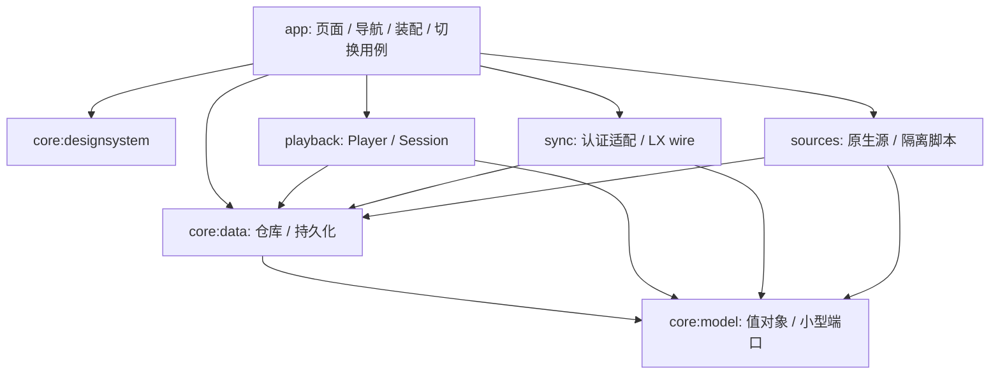

# 03 · 原生 Android 架构样本与建议

> 决策更新（2026-11-14）：本文保留原始研究结论与建议，不是当前实施规范。已确定先 LX、后 Lux；SDK 33/36、Hilt、dev/main、同包名开发/稳定通道、独立本机资料。最新要求见 [plan.md](../plan.md)，与历史建议冲突时以最新计划为准。

先读仓库，再作选择。本表来自实际源码/Gradle/workflow 阅读；路径与固定 SHA 见 [sources.md](sources.md)。没有用 stars 数量替代质量判断，也没有将下载到源码等同于已构建成功。

## 选择样本的理由与反例

| 项目 | 已读证据 | 值得吸收 | 本项目不照搬 |
| --- | --- | --- | --- |
| android/nowinandroid | Architecture/Modularization learning journeys、settings.gradle.kts、OfflineFirstTopicsRepository、ForYouViewModel、Build/Release workflow | 本地数据观察、事件向下/状态向上、边界模型、按价值使用 domain、convention plugin、可替换测试数据 | 其模块已细到 feature api/impl 和许多 test module；零起步照抄会把维护任务放大。其 CI 自动更新 baseline/PR 等策略也不适合直接搬来 |
| OxygenCobalt/Auxio | PlaybackStateManager、PlaybackViewModel、PersistenceRepository、ExoPlaybackStateHolder、README | 状态所有者、UI 不直接驱动 ExoPlayer、持久队列独立职责、本地媒体能力 | XML/Fragment 与其自定义播放状态设计不必复制；源码明确没有把 MediaSession 当内部状态中枢，不能误称所有优秀播放器都同一架构 |
| MetrolistGroup/Metrolist | MusicService、LoginScreen、AccountViewModel、settings、build workflows | MediaLibraryService 与系统控制、Compose 客户端、单独源模块、功能变体成本意识 | 本次 MusicService 约 5080 行、LoginScreen 约 600 行；浏览器 cookie/JS 提取登录为其服务特例，不适合作 Lux 账号；不照搬超大 Service 或 GMS/FOSS 多变体 |
| JunkFood02/Seal | Task/TaskFactory/DownloaderV2、DownloadService、ViewModels、settings、CI | 下载任务状态、执行层与展示层划分；PR 检查与手动签名构建分开 | 其 yt-dlp/外部工具栈不适合作音乐源架构；workflow 某些浮动 action/version 只作审阅素材，不当最佳实践 |
| CappielloAntonio/tempo | ServerRepository、ServerDao、LoginViewModel、LoginFragment、添加服务器 dialog/XML | 自托管音乐的服务配置列表、明确条目与编辑、数据访问层 | Java/XML + LiveData 是真实原生范例，但不因此选择旧 UI 技术；ServerSignupDialog 实际是保存配置，不是创建远端账号；不沿用混淆命名 |
| jellyfin/jellyfin-android | ServerSelection、ServerUser/ServerEntity、测试 workflow | 分开 server/user，先验证服务器再连接，保存/发现历史入口、SHA 固定 Actions | README 明确主要客户端是 web wrapper；只借原生连接外壳与数据关系，**不能作为本项目 WebView 实现理由** |
| finamp-app/finamp | LoginFlow、server/user selection、authentication page | 音乐业务的多步登录、返回关系、Autofill、isAuthenticating 防重复 | Flutter，不计入原生 Android 架构样本，只作账号流程对照 |

另外检索过 InnerTune、ViMusic、Harmony-Music；ViMusic 的仓库元信息已 archived，Harmony 是 Flutter；本轮未深读它们的实现，故不列为主要依据。错误的仓库旧地址曾返回 404，之后通过搜索确认 Tempo/Finamp 实际地址，见来源说明。

## 推荐的技术组合（研究建议）

| 领域 | 首选方向 | 原因 / 限制 |
| --- | --- | --- |
| 语言与 UI | Kotlin + Jetpack Compose，单 Activity | 自定义 ui/ 精确复刻；Compose 是原生 UI，不包网页。Material 可作基础但视觉用自己的 token/shape/绘制 |
| 状态 | ViewModel + StateFlow、结构化协程、生命周期感知订阅 | Screen state 为不可变快照；不复制 JS global store、事件总线和 callback 导航链 |
| 播放 | Media3 ExoPlayer + MediaSessionService；需要浏览媒体库时用 MediaLibraryService | Player/Session 属于 Service，Activity 不拥有；系统通知/蓝牙/音频焦点同一条命令链 |
| 数据 | Room（关系/事务/查询）+ DataStore（小型设置） | DataStore 不存整个媒体库或下载队列；Room 不是网络 DTO 缓存桶 |
| 网络 | OkHttp + kotlinx.serialization；REST 可选 Retrofit | REST 和 WS 共用受控 transport/config；是否引入 Retrofit 看 DTO/API 数量，不同时引入 Ktor 再造第三套 |
| 图片 | Coil | 原型 SVG 封面/真实封面按实际 decoder 和裁剪验证；不让封面获取影响播放生命周期 |
| DI | 小规模 Hilt，构造函数注入 | 样本生态成熟、生命周期清楚；不同时引入 Koin/service locator。模块数很少时纯构造器装配也可，需统一一种 |
| 后台任务 | WorkManager 处理可延期/可恢复任务；实时播放/连接遵循各自生命周期 | Worker 不是永久 WebSocket 守护；播放 Service 也不包办所有同步和下载 |
| 下载 | 优先验证 Media3 DownloadService/DownloadManager 能否满足实际媒体格式与导出 | app 自有离线缓存与导出用户文件是两种能力；若不满足再采用一套 Room+原生任务执行，禁止两套下载 owner |
| 构建 | Gradle Kotlin DSL、version catalog、wrapper、少量 convention plugins | 固定可兼容的 JDK/AGP/Kotlin/Compose 版本组合；本轮不凭样本最新版本直接选版本号 |

官方依据：[Android 架构建议](https://developer.android.com/topic/architecture/recommendations)、[Media3 后台播放](https://developer.android.com/media/media3/session/background-playback)、[Media3 下载](https://developer.android.com/media/media3/exoplayer/downloading-media)。这些是边界依据，不代替本项目源码和实际设备验证。

minSdk、target/compileSdk、JDK/AGP/Compose 具体版本留到工程创建前检查官方兼容表并确认支持设备。倾向 minSdk 26 作为讨论起点，**未定案**，不能借精简之名默默放弃旧用户。

## 模块化的三个选项

| 选项 | 成本 | 判断 |
| --- | --- | --- |
| 单 app，按 package 分层 | 最快；容易让 source、sync、UI 互相引用 | 很短的技术探针可用，不建议承担最终全量业务 |
| 少量模块按运行边界拆分 | 需要维护少量 API，但能隔离播放、协议与外部源 | **推荐**；初始 7 个模块以内，不为每个页面建 module |
| 完整 NIA/Clean 多层 + 每功能 api/impl + 每仓库 use case | 初期大量空壳、构建配置和跳转 | 暂不采用；有真实多人协作、依赖或构建瓶颈再提取 |

推荐起点如下，名称为建议，不是本轮创建的目录：

| 模块 | 唯一职责 | 不允许 |
| --- | --- | --- |
| `:app` | Compose 页面、导航、DI 装配、账号切换用例 | 直接 SQL、实现 wire 协议、直接读写密钥 |
| `:core:model` | 纯 Kotlin 值对象和少量跨运行边界端口（Account/Workspace/Track/PlaybackCommand 等） | Android Context、数据库实体、各源原始响应、万能 util |
| `:core:data` | 资料库/设置/凭据仓库、Room、DataStore、序列化持久数据 | 依赖 app、sync、playback 或 sources 的实现 |
| `:core:designsystem` | ui/ tokens、基础可复用组件、图标 | 网络调用、账号副作用 |
| `:playback` | 唯一 Player/Session、队列、焦点与播放生命周期 | 注册/登录、UI 导航、任意库的业务逻辑都塞进 Service |
| `:sync` | LX wire codec、REST auth adapters、WS 会话/模块同步 | 访问当前页面、隐式切资料库、改 server |
| `:sources` | typed source API、脚本兼容运行时、URL/封面/歌词/评论解析、请求预算 | 持有 Lux/LX 账号凭据、运行任意脚本读取 app 数据 |

下载初期在 core:data 的持久任务仓库 + 单一执行适配中组织；若需要独立 Android Service/原生引擎和稳定 API，再提取 `:downloads`，不第一天就空拆。together、history 同理先在明确 package 内聚；不是每一行边界都必须一个 Gradle module。

装配层将 `TrackResolver` 注入 playback：playback 不静态依赖 sources 的具体实现。Data 的凭据存储可提供高层仓库实现，但运行边界只拿所需的最小接口。不要让 core:model 变成所有接口的垃圾场；局部接口放回所属模块。

## 单一状态所有者，而不是“所有状态只有一个大 store”

| 状态 | 所有者 | 读取者 |
| --- | --- | --- |
| 实时曲目、进度、播放/暂停 | PlaybackController/Player，Service 生命周期 | Mini、全屏、歌词、通知、一起听 |
| 收藏、歌单、历史 | 当前 Workspace 的 Room repositories | UI、推荐、同步 |
| 账号/资料切换 | 单个 SessionSwitcher 用例 | app 导航、同步/播放任务的 scope |
| token、device key | CredentialRepository | 对应 auth/sync adapter；UI 只看有无凭据 |
| 表单/焦点/弹层/Tab 滚动 | Screen ViewModel / SavedStateHandle / Compose saveable | 当前页面；不写成全局业务状态 |
| 同步 | SyncSession，分模块 ready 与 typed errors | 状态栏/设置；不把 WS open 视为数据已同步 |
| 下载 | 一套持久任务状态 + executor | UI 只订阅，不维护第二份“权威”状态 |

屏幕声明 `UiState` + typed action；简单读取直接观察 repository，只有跨仓库事务/复杂规则才建 use case。不要每个 getter 再包一层 UseCase，也不需要第三方 MVI 框架才能做到单向数据流。

## 资料和凭据隔离建议

推荐一个小型 metadata 数据库保存服务器、账号引用、资料索引、切换恢复记录；每个 Workspace 一个资料数据库/文件根路径。每次只打开 metadata + 活跃资料，避免所有账号同时开库。Schema migration 是原生新 schema 的演进，不承担 RN 无限版本兼容。

统一 DB 加 ownerId 也可行，但需要所有 query/join/事务都不漏 owner 约束；在本项目特别重视账号隔离的背景下，分库更容易验证。代价是跨资料复制需明确导入事务，不能 SQL 一条无提示合并。

密钥用 Android Keystore 保护的加密存储；Room/设置只保引用，排除不可恢复密钥材料的自动备份。access/refresh/device key 整组发布与崩溃恢复要设计一致，不把 token 原文塞 SavedStateHandle、导航参数、截图、日志或下载 URL 元信息。

所有长任务捕获 `(workspaceId,generation)`，提交时再核对；旧响应可被丢弃但不能写入新空间。实际取消协程与“无权发布”双保险属于必要隔离，不是应该删掉的冗余。

## 外部源是最主要的兼容边界之一

“原生实现”应指 app/UI/播放/数据主链原生，不应在调研阶段直接宣布删除已有 LX 自定义源脚本。mobile 已使用 QuickJS，实际用户脚本 ABI 值得兼容。建议：

- 内部使用小而明确的 `search/resolve/lyrics/comments/playlist` 能力接口，具体源能力不同用 capability 表表达。
- 旧脚本 ABI、回调和 HTTP response shape 只在 sources runtime；不向全 app 暴露 RN `NativeModules`/Buffer/global。
- 候选引擎需验证 ABI、CPU 架构、线程中断、内存/执行时间预算、取消、二进制响应；本轮未选定 QuickJS binding 或版本。
- runtime 不拿 app auth、任意文件、数据库/导航对象；脚本要求的网络请求由宿主代理并处理超时、重定向、日志脱敏。
- 本轮没有逐源线上可用性验证；不能因为查到源码就保证 QQ/网易等现网接口持续可用。

## 明确不采用的设计

不 fork mobile 工程改壳；不共存 RN 与 Compose 双 UI；不全应用 WebView；不先做通用插件市场/万能事件总线/动态 feature engine；不为所有历史 server 写猜测 fallback；不把“认证成功、WS open、list ready、together ready”混成一个 boolean；不把所有协程设为永不结束的 application scope。

这些取舍要通过 [06 的验证门槛](06-decisions-and-validation.md) 再转成最终 ADR；本轮没有创建模块或锁定依赖。
