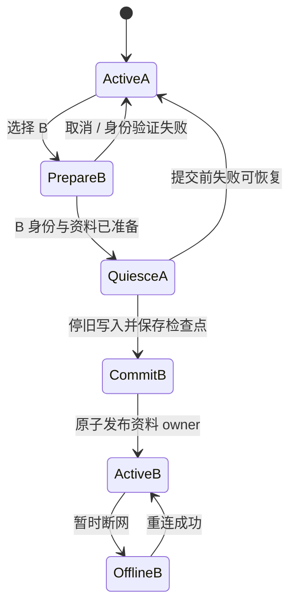

# 04 · 登录、注册与账号切换调研

> 决策更新（2026-11-14）：本文保留原始研究结论与建议，不是当前实施规范。已确定先 LX、后 Lux；SDK 33/36、Hilt、dev/main、同包名开发/稳定通道、独立本机资料。最新要求见 [plan.md](../plan.md)，与历史建议冲突时以最新计划为准。

目标是让用户知道“我正在连哪台服务器、以谁的身份、使用哪份资料、是否已同步”。界面仍使用本项目设计语言；不把商业软件皮肤或原生系统默认表单直接搬进来。

## 样本与证据等级

开源源码使用 [固定提交](sources.md)；商业产品使用本轮已打开的官方页面。未进行真实注册、支付、密码输入或 Android App 操作，也未取得这些商业产品的完整动态页面截图；以下评价针对结构和流程，不声称量过每一处像素。

| 对照 | 已核实内容 | 吸收的经验 | 不采用 / 限制 |
| --- | --- | --- | --- |
| [Spotify 登录](https://accounts.spotify.com/en/login)、[注册](https://www.spotify.com/signup) | 本次网页先收 Email，单一继续/下一步，第三方方式分组，登录与注册互相有入口；注册页区域重定向到 jp | 一步一主任务、清楚的“已有账号”路径 | Lux 用 username，不能改成 email；不添加 server 不支持的 Google/Apple 登录；本次没走到密码或验证码下一步 |
| [Apple Music Android 官方说明](https://support.apple.com/en-us/109340) | 明确 Use Existing Apple Account / Create New Apple Account；已有订阅用户可直接登录 | 登录与新建账号的文案及目标分明；避免把已有账号送进注册 | 不照搬订阅/付款；支持文章是流程证据，非当前原生像素证据 |
| [TIDAL 注册官方说明](https://support.tidal.com/hc/en-us/articles/115003671729-Sign-up-for-Tidal) | 邮箱、公开 profile name、出生信息和后续订阅步骤分属账号/档案/付费内容 | 账号凭据与展示昵称不同，昵称可修改 | Lux 不需要生日/付款；`login.tidal.com/` 根地址本次 404，未把搜索缓存的授权 URL 当完整登录实测 |
| [Symfonium 管理 provider](https://docs.symfonium.app/wiki/settings/settings-manage-media-providers/)、[WebDAV 配置](https://docs.symfonium.app/wiki/providers/webdav-media-provider-configuration/) | 有独立管理列表和 Add；按 provider 填完整 URL/账号；连接时验证 | 连接服务与个人身份是不同对象，多服务入口不应挤到一个万能登录按钮 | 不直接照搬所有 provider 类型和高级选项；与 LX 同步身份并非同一协议 |
| Tempo（原生） | 服务器列表、添加/编辑对话框含名称/用户名/密码/服务器/本地地址，密码显示切换 | 服务记录可以回访、编辑，输入错误定位到字段 | `ServerSignupDialog` 并不注册远端账号；Lux 要叫“添加连接”。长按删除和低安全模式不适合作主路径 |
| Finamp（Flutter，仅 UX） | server-selection → user-selection → authentication，返回所选账号；用户名/密码 Autofill、IME next/done、防重复认证 | 渐进显示、表单键盘与返回路径也是架构的一部分 | Lux/LX 无公开用户枚举，不能抄“列出该服务器所有用户”；不引入 Flutter |
| Jellyfin Android 原生连接页 | saved/discovered server suggestion、pending/success/error 状态、提交去重 | 服务器错误与凭据错误分开、已存记录可恢复 | 主客户端 WebView 不采用；不因它支持发现就推断 LX 有发现协议 |
| Metrolist 原生 Compose | 登录有 Authentication/CheckingAccounts/SelectingAccount/SwitchingAccount/Completing 多阶段 | 明确选择与完成阶段，避免点一次后隐式换身份 | Google WebView/cookie/JS 提取不适合 Lux，禁止照抄 |

商业资料只提供流程事实；下面是本项目建议，而非声称上述产品都按同样方式切换账号。

## 现有问题应从语义解决

mobile 本次代码已加入 ServerStep、AuthFlow、AccountSpaces、LoginGate 和 AppSessionCoordinator。它们反映了认真修复隔离的努力，但页面仍需要理解 settings/onboarding/旧新开关、同步模式、已有凭据复用、资料切换等多条路径。新项目无需继承这些路径数量。

**建议使用四种互不混淆的对象：**

| 对象 | 是什么 | 不是 |
| --- | --- | --- |
| Server | 确认过的 base URL、serverId、名称、能力 | 某个用户、某份本地资料 |
| Account | Lux `serverId+userId` 或本地 LX binding | 昵称、连接是否在线 |
| Workspace | 本机该身份的歌单/历史/队列等资料 | token 或全局“唯一 local” |
| Connection | 某账号当前认证、WS 和各同步模块状态 | 已登录身份本身 |

首页显示离线标记不改变 Account；切连接地址不自动合并资料；注销连接不隐式删除 Workspace。

## 建议页面与信息结构

### A. 初次启动

建议主入口“连接同步服务”，并明确提供“先在本机使用”。用户已经有资料时先进入可用本机内容，不因为服务器离线被永久困在登录页。全屏 onboarding 是否强制是产品待确认项；这里建议不强制。

### B. 添加连接：先服务器，再认证

1. **服务器页**：地址输入、近期服务器、检查按钮/状态；最多一项主要“继续”。完整服务地址始终可见且可编辑，保留部署路径。
2. **认证方式**：现代 Lux 根据已核实能力直接显示账号表单；不能确定旧服务时让用户选择“Lux 账号”或“LX 连接码”，解释用途。这个选择不出现在已经确定身份的每次重连。
3. **Lux 登录**：显示服务器名称/地址和“更换服务器”；用户名、密码、显示密码、登录；次级“邀请码注册”“忘记密码/联系管理员”。不要求每次输入资料名称、同步格式、设备 ID、冲突策略。
4. **LX 连接**：只显示服务器、连接码、设备名称（可折叠默认值）、连接按钮；解释连接码来自服务管理员。没有用户名、注册或忘记密码假入口。

HTTP/TLS/地址错误在服务器页，401 INVALID_CREDENTIALS 在登录页，注册邀请码错误在注册页；统一 toast 不能替代持久可读的错误说明。鉴权请求不跨不同 origin 自动重定向发送 token。

### C. 注册：适配真实合同

现代：邀请码校验 → 账号/密码/确认密码 → 可选昵称 → 注册并继续。邀请码更改要清掉旧校验结果；提交前二次核对当前表单与校验关联，限制重复提交。密码可见开关、Autofill、IME、键盘避让需原生处理。

旧 Lux：无 invite/check 时直接填邀请码并提交 register；成功后提示“账号已创建，正在登录”，再登录；若后者失败，可重试登录，不重新消费邀请码。不要因为缺预检就把可用注册完全封死。

公开注册、邮件/短信验证码、社交登录、在线重置密码均无现有 server 合同，不出现无效按钮。支持 server-info 的部署按 registration 决定是否显示注册；旧部署能力未知时说明邀请码方式，不伪称已确定“注册开放”。

密码长度/字符规则是服务端合同与产品规则的交集，不能因参考 mobile 的本地 ≥8 校验就误说 server 必然同一限制。先保留最小必填/确认一致，最终规则另核对或明确为客户端产品要求。

### D. 账号中心与切换

- 当前身份卡：昵称/用户名、服务器名+地址、资料类型；连接状态用单独一行。
- 账号列表：本机、已保存的 Lux 账号、LX 连接；每项清晰显示身份、服务器与离线/需登录状态。
- 主动作“切换到此账号”，新增用“添加账号或连接”。编辑连接、退出、移除记录、删除本机资料是不同操作，不混成一个“清除账号”。
- 仅在跨资料操作需要时显示“复制本机歌单到此账号”的独立导入入口，默认不合并、不覆盖。
- 本地昵称不是 Lux username；同昵称不同 server 不能合并，同 server 改昵称也不能新建资料。
- 不为“切换”先执行远端 logout；用户可以保留多个凭据并明确退出其中一个。

## 切换事务：建议模型

这不是把所有资源都留到最后一刻才取消：PrepareB 只允许认证和只读准备，不应用 B 的同步写入；必要时允许 A 继续播放。短暂提交窗口内暂停/保存 A 队列与统计、退出一起听、停止旧同步写入、处理下载 owner，然后切换到 B。B 初始同步有冲突时在 B 的明确上下文选择，不能在 A 还 active 时写 B 数据。

App 仅有一个 SessionSwitcher 和一个持久 switch record（previous/target/phase/generation，不含密码）。提交点是 metadata 事务中 activeWorkspace 的发布；准备失败恢复 A，已提交后失败留 B 离线可用，禁止“随意回滚一半数据”。进程恢复读取提交记录再决定展示哪份资料。

Compose 页退出只能取消表单任务；Service/同步/下载按 owner scope 退出，不靠某个页面是否 mounted。提交后旧 HTTP/WS/下载回调必须因 generation 或 owner 不匹配拒绝发布。

这是建议的正常路径优化，与 mobile 当前先进入 Gate 的策略不同；需要通过 06 中崩溃点和并发测试后才能选定。

## LX 身份的特殊限制

原版 LX 连接码能映射到服务器用户，但返回结果没有稳定 userId。不能假设 `serverId` 唯一代表账号，也不能把不同连接码的 key 随意重用。

建议首次连接分配本地 `bindingId`，以 `(serverId,bindingId)` 建独立 Workspace；保存的设备 key 绑定该 binding。用户主动换连接码默认视作新增连接，可明确选择沿用某份资料但必须重新认证并说明同步风险。不能把低熵连接码直接作为文件名/日志/账号 ID。是否继续 mobile 的“LX 与 local 共用资料”是待确认产品选择，当前建议隔离。

## 失败与反馈矩阵

| 情形 | 用户看到的状态 | 允许操作 / 不应发生 |
| --- | --- | --- |
| 地址无效 / 子路径错误 | 地址字段提示 | 编辑重查，不清已有身份 |
| 超时/断网/5xx | 暂时无法连接 | 重试/继续当前资料；不要求重新注册 |
| 密码错误 | 登录错误 | 重试、显示密码、联系管理员；不清原账号数据 |
| 401 access 过期 | 自动一次续期，失败再需登录 | 现代 single-flight；网络续期失败保留凭据 |
| 403 权限不足 | 无权执行该操作 | 不一律登出；INVALID_CURRENT_PASSWORD 提示旧密码错误 |
| 429/Blocked IP | 尝试过多/稍后重试 | 退避，不不停重试导致封锁 |
| refresh 被撤销 | 此账号需要重新登录 | 保留本机资料、取消后台提交，显式重新认证 |
| key 拒绝/设备冲突 | 同步需重新授权 | 同账户恢复流程；不是换个账户 key 试试 |
| 邀请码失效/用尽/用户重名 | 对应字段错误 | 保留其他输入；无敏感内容日志 |
| 数据冲突 | 展示本机/服务器数量、合并/覆盖/取消 | 不因“登录成功”自动上传覆盖所有歌单 |
| 切换取消 | 原身份、原资料、原队列恢复 | 不新增幽灵 active 账号 |
| 移除账号记录 | 单独确认影响范围 | 不等同于远端删除用户；server 无此普通接口 |

## 与 ui/ 1:1 要求的关系

原型账号页是示例昵称+本地/Lux/LX 分段，明确不真正登录。它无法完整表达这里的真实注册、续期、多账号切换。本轮依据用户的新要求研究改进，但 **不修改 `ui/`、design.md、AGENTS.md**。下一步应先把选定的新账号页面/状态补成设计基准，限定账号部分的变更范围；其他音乐页面继续严格 1:1，不能借账号优化顺手重排播放器或导航。
